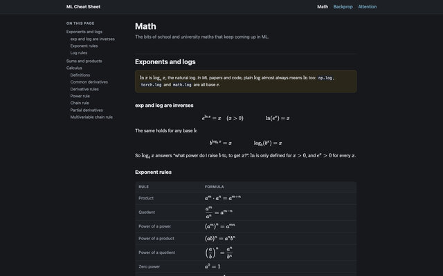
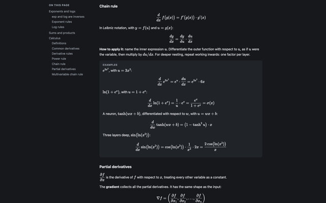

# ML Cheat Sheet

📄 [Read it here](https://catchouli.github.io/ml-cheat-sheet/)

My own reference for the maths and ML I keep needing to look up: formulas, definitions and short worked examples, one page per topic.

I'm working through building transformers from scratch, and to get through backprop I had to re-remember (or re-derive) a load of maths I hadn't touched in a long time. This is the tidy version of the pages in my notebook, so I don't have to derive the chain rule for sums again next time.

## What's in it

It goes from plain maths, to how neural networks learn, to transformers:

**Math** has exponent and log rules, sums and products, a table of common derivatives, and the power rule, chain rule, partial derivatives and the multivariable chain rule, each with a few worked examples.

**Gradient descent** is the big picture: loss, gradients and the update rule, backprop as the multivariable chain rule, a two-layer network worked through forwards and backwards, and momentum, Adam and AdamW.

**Layers** goes through linear, tanh, sigmoid, ReLU, GELU, softmax and the losses one at a time: what each does, what it's for, and its derivative with the derivation.

**LayerNorm** gets its own page, because its backward pass took me about ten pages of notebook to derive. Here it's five steps.

**Attention** covers queries, keys and values, the causal mask, multi-head attention and the backward pass.

**Position encoding** goes from the sine waves in the original transformer paper, through learned embeddings and relative biases, to RoPE.

## How it works

It's plain HTML and CSS, with formulas written in LaTeX and rendered in the browser by [KaTeX](https://katex.org/), so there's no build step. Pushing to `main` deploys it to GitHub Pages.

To read it locally, open `index.html`, or serve the folder with `python3 -m http.server`.
